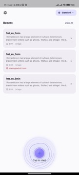
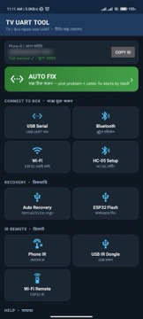

## Hi, I'm Al Rasin

Flutter & Android developer from Dhaka, Bangladesh. I build mobile apps that real people use, on both the Play Store and the App Store.

### Currently

- **Mobile Application Developer** at [TubeOnAI](https://play.google.com/store/apps/details?id=com.tubeonai.app) (remote): an AI summarizer app for YouTube videos, podcasts and documents with 150k+ users.
- **Mobile App Development Consultant** at **Pinova Technologies**: building a native Android parental-control app (Kotlin, Jetpack Compose, Firebase) for an EU client.

### Featured projects

| | Project | What it is |
|---|---|---|
|  | **Transcribr** | Offline transcription app for Android and iOS that runs whisper.cpp on the phone. Source is private; [privacy policy](https://al-rasin.github.io/transcribr-legal/). |
|  | [TV UART Tool](https://github.com/Al-Rasin/tvuarttool-releases) | Android app for repairing TV boxes over UART (USB, Bluetooth, Wi-Fi) with an AUTO FIX for common boot problems. |
|  | [Jimi](https://github.com/Al-Rasin/jimi) | Offline voice assistant for a rooted Android phone: wake word, speech to text and small local LLMs. Kotlin, llama.cpp, sherpa-onnx. |
| | [Focus Guard](https://github.com/Al-Rasin/focus-guard) | Self-control tool for rooted Android and macOS: adds friction to Shorts and Reels and blocks adult content. |

### Live apps

- **TubeOnAI**: [Google Play](https://play.google.com/store/apps/details?id=com.tubeonai.app) · [App Store](https://apps.apple.com/us/app/tubeonai-summarize-anything/id6451212292)
- **HelloTask**: [Google Play](https://play.google.com/store/apps/details?id=com.robotlogistics.callrobot)

### Tech stack

Flutter · Dart · Kotlin · Jetpack Compose · Riverpod · Firebase (Firestore, Cloud Functions, FCM) · REST · SQLite/Hive · GitHub Actions

### Contact

[Portfolio](https://al-rasin.github.io) · [LinkedIn](https://www.linkedin.com/in/al-rasin-64ab7822a) · [WhatsApp](https://wa.me/8801752591363) · alrasin500@gmail.com

B.Sc. in CSE, Southeast University · Diploma in Mechatronics, Magura Polytechnic Institute
